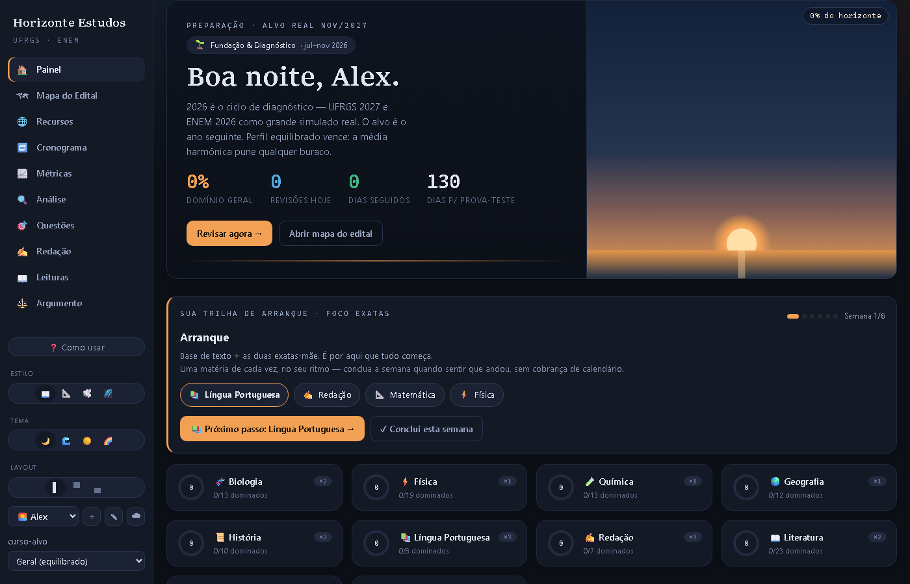

# Horizonte — Painel de Estudos (ENEM / UFRGS)

PWA de estudos **offline-first, sem frameworks** (vanilla JS puro), com sincronização
multi-dispositivo via Cloudflare (Pages + Functions + D1 + Worker de push).
Feito para preparação ENEM/vestibular UFRGS, mas a arquitetura serve para qualquer
painel pessoal de estudo.



> Todos os nomes e dados pessoais foram substituídos por personagens fictícios
> (**Alex**, o titular; **Bia**, a convidada). Os dados de provas são públicos (ENEM/UFRGS).

## O que tem dentro

| Módulo | O que faz |
|---|---|
| `painel/` | O app em si: HTML + JS vanilla, PWA instalável, funciona 100% offline |
| `painel/*-data.js` | Dados gerados: banco de questões oficiais classificadas por tópico, frequência por assunto, edital interativo, leituras obrigatórias, redações nota mil, rubricas de correção |
| `functions/` | API (Cloudflare Pages Functions) para sync de estado entre dispositivos |
| `worker-push/` | Worker de notificações push (Web Push + VAPID) |
| `pipeline/` | Scripts que baixam/classificam provas e geram os `*-data.js` |
| `pipeline/verificar/` | Probes headless (CDP) que validam o painel: offline, largura, visual |
| `infra/schema.sql` | Schema do banco D1 (perfis, estado, sync) |
| `docs/estudo/` | **Material didático completo**: cada arquivo do código explicado linha a linha |

## Destaques de arquitetura

- **Zero dependências no front.** Sem build, sem bundler: `<script src>` e pronto.
- **Offline-first de verdade.** Service worker com cache versionado; o painel abre
  em modo avião, e o sync reconcilia depois (last-write-wins por chave).
- **Dois perfis, um deploy.** O mesmo código serve o painel completo (com cofre
  Obsidian local) e o "painel-presente" (`--kit`), uma versão-presente publicada
  para outra pessoa, sem cofre — a detecção é em runtime (`semCofre()`).
- **Dados como código.** O pipeline transforma PDFs/provas em `*-data.js` commitados:
  o front nunca depende de API para conteúdo, só para sync.

## Como rodar

```bash
# 1. Local: qualquer servidor estático resolve
npx serve painel

# 2. Deploy (Cloudflare Pages + D1)
#    - crie um banco D1 e cole o id em wrangler.toml (SEU-DATABASE-ID-AQUI)
#    - aplique infra/schema.sql
npx wrangler pages deploy painel

# 3. Push (opcional) — ver docs/ATIVAR-PUSH.md (gera par VAPID e sobe o worker)
```

## Trilha de estudo (docs/estudo)

Se você quer **aprender** com este projeto, comece por:

1. `docs/estudo/ROTEIRO.md` — ordem de leitura sugerida
2. `docs/estudo/ARQUITETURA.md` — visão geral e diagramas
3. `docs/estudo/*.explicado.md` — cada arquivo-fonte comentado em profundidade
4. `docs/estudo/EXERCICIOS.md` + `LABORATORIO.md` — para praticar em cima do código

## Estado

Revisão de 09/10/2026 (ambiente de nuvem, headless). O código roda como está; o deploy é
**manual** (`wrangler pages deploy painel`) — **push ou merge neste repositório não publica nada**.
O único workflow (`.github/workflows/sondas.yml`) só testa; não faz deploy.

**Tecnologias:** HTML + CSS + JavaScript puro, Service Worker, `localStorage`, Cloudflare
Pages Functions + D1 (SQLite) + Worker com cron para push; pipeline em Node e Python.

**Como testar** (Node ≥ 22 e um Chromium; nada para instalar):

```bash
export CHROME=/caminho/do/chromium        # só se ele não estiver em ~/.cache/ms-playwright
npm test                                  # unitários (datas, fuso Brasil) + "sem as fotos" no Chromium
python3 -m http.server 8899 &             # as sondas abaixo esperam a porta 8899
node pipeline/verificar/audit-mobile.js   # celular 390px: vazamento, alvo pequeno, campo < 16px
node pipeline/verificar/probe-nav.js      # (e probe-offline-1visita, sweep-abas, probe-pwa…)
```

Resultado em 09/10: `npm test` 6/6 + sem-fotos OK; as 5 sondas passam sem erro de JS.

### Sem as fotos e bilhetes (estado do site no ar)

As fotos da dedicatória e as imagens dos bilhetes ficaram fora do repositório (material
privado). O painel degrada sem elas: se uma foto não carrega, ela some; se nenhuma carrega, a
moldura inteira some (sem buraco); a imagem do bilhete idem — fica só o texto. Coberto por
`pipeline/verificar/test-fotos.js`. Sem `perfil-seed.js` o painel abre normal, sem dedicatória.

### Como importar o kit de fotos depois

1. No pendrive estão o `perfil-seed.js` e a pasta de imagens. Copie para `painel/`:
   `perfil-seed.js` e, p.ex., `painel/fotos/…` (os caminhos em `dedicatoria.fotos` e
   `mensagens.imagens.meta|animo` do seed são relativos a `painel/`).
2. **Suba o `CACHE_V` em `painel/sw.js`** para o próximo número livre (hoje `horizonte-v34` →
   `v35`; o `v33` que este passo reservava fica sem uso — a correção de 16/10 usou o `v34` para
   não colidir com ele). Sem isso, quem já
   abriu o site tem o 404 do `perfil-seed.js` guardado no cache do service worker e só vê o
   kit na 2ª recarga.
3. Se quiser as imagens funcionando offline, acrescente-as à lista `DADOS` do `sw.js`
   (o `perfil-seed.js` já está lá).
4. `npm test` e depois `npx wrangler pages deploy painel` (manual). Não commite o kit se o
   repositório for público — é pessoal.

## Pendências

- Importar o kit de fotos/bilhetes (acima) — depende do pendrive.
- O PR com estas correções está em rascunho: **nada foi mesclado nem publicado**; depois do
  merge ainda é preciso rodar o deploy manual para o site no ar receber as correções.
- `test-qr.js` precisa de um venv com `opencv-python-headless` e assume caminho Linux (`.venv/bin/python`).
- `mergeSecao` (sync) une listas por `id`: um item apagado num aparelho reaparece se o outro
  ainda o tem. É decisão de projeto (não perder progresso), mas vale saber.
- Sessões de estudo gravadas antes desta revisão usam data UTC; as novas usam data local.
  Nada é reescrito; no máximo uma sessão noturna antiga aparece um dia à frente.

## Auditoria adversarial de 16/10/2026

Achados reproduzidos (cada um com teste que falha no código antigo e passa agora):

1. **Estado corrompido derrubava o boot** — `app-core.js` (`loadIndex`, `load`) e `app.js`
   (`importData`) aceitavam qualquer JSON: índice `{}`/`null`, `sessions:null`, `curso` removido
   ou sessão `null` davam `TypeError` e tela em branco (só limpando os dados do site). Agora
   `painel/estado.js` sanitiza (índice, listas, mapas, curso, sessões inválidas). Testes:
   `test/estado.test.js` e `pipeline/verificar/test-estado-corrompido.js` (11 variantes no Chromium).
2. **Minutos da sessão** — `app-plano.js` `logSession` usava `parseInt`: `1e3` virava 1 min,
   `12abc` virava 12 e `99999999` era aceito (estraga barras e totais). Agora `parseMin`
   (inteiro 1–1440); entrada inválida só devolve o foco ao campo.
3. **Alvo de toque < 44px** — 35 controles de 34–41px no celular (botões, selects, campos, chips do
   painel, slider do simulador). `index.html` (`@media(hover:none)`) e `app-painel.js:108`; o limite
   de `audit-mobile.js` subiu de 32 para 44px (falhava com 35 achados, agora 0).

Suposição, **não reproduzida**: teclado do celular cobrindo campo dentro de `<dialog>` (o CSS usa
`vh` e nada lê `visualViewport`). Não há teclado virtual no Chromium headless, então não dá para
provar; fica para teste em aparelho real. Datas/fuso: sem achado novo (a revisão de 09/10 já cobriu).

## Estado: `min` em texto e sync sem sanitização (16/10/2026)

1. **`min` salvo como texto** — `normalizaEstado` aceitava `min: "30"` (e `null`, que virava 0)
   sem converter; em `renderWeek` o total `totals[d] + "30"` concatenava ("003015null min",
   "NaNhNaNmin"). Agora `minSalvo` (em `painel/estado.js`) devolve `+min` como número e mantém
   **exatamente** as sessões que a regra anterior mantinha (`+min` finito ≥ 0): `null`/`""` viram 0,
   `"30"` vira 30, `"1e3"` vira 1000. Sai só o que já saía (`"12abc"`, ausente, negativo, infinito).
   Revisão de 16/10: a 1ª versão descartava `null`/`""`/booleano/`"1e3"` — perda de sessão que a
   main preservava; o histórico mostra que o app sempre gravou `min` como inteiro ≥ 1
   (`parseInt` + `if(!min||min<1) return`, depois `parseMin`), então esses casos só vêm de
   backup editado à mão ou servidor, e mesmo assim não se apagam. É mais tolerante que `parseMin`
   (sessão com 0 ou > 1440 min continua). O objeto de entrada não é alterado.
2. **`Sync.pull` sem sanitização** — `applyRemote`/`mergeSecao` (`painel/sync.js`) punham o
   remoto cru em `S`: `curso` inexistente derrubava o painel (`CURSOS[S.curso].pesos`),
   `topics:"lixo"`/`questions:null` e `min` texto idem. Agora, se alguma seção mudou, o
   resultado do merge passa por `normalizaEstado` (a mesma do `localStorage`) antes do `save()`.
3. `CACHE_V` `horizonte-v32` → **`horizonte-v34`** (`estado.js` e `sync.js` são servidos; `v33`
   estava reservado ao kit de fotos).

Testes que falhavam antes e passam agora: `test/estado.test.js` (min texto/null; mesmas sessões
mantidas que a regra anterior, para 30 valores de `min`; estados válidos
de 3 perfis idempotentes; entrada não mutada) e `test/sync.test.js` (novo: carrega `estado.js` +
`sync.js` num `vm` com `fetch` simulado — remoto ruim sanitizado, remotos válidos de 2 perfis
intactos com `trilha`/`foco` locais preservados, união por `id` mantém locais e remotas válidas);
`pipeline/verificar/test-estado-corrompido.js` ganhou "min texto no localStorage" (total da semana
= 45 min) e "Sync.pull com remoto ruim" (7 abas abrem sem erro). Resultado: `npm test` 21/21 +
sem-fotos + estado corrompido OK; sondas `audit-mobile`, `probe-nav`, `probe-offline-1visita` e
`probe-pwa` sem erro de JS (cache `horizonte-v34`). Pendente: nada mesclado nem publicado.

## Correções da revisão de 09/10/2026

1. **Data em UTC (`todayKey`)** — no Brasil, depois das 21h o "hoje" virava amanhã: sessão
   de estudo, tentativa no banco e simulado gravados no dia errado, gráfico dos últimos
   7/14 dias e sequência (🔥) quebrando à noite. Agora `painel/datas.js` usa o fuso local.
   Testes: `test/datas.test.js` (falham com o código antigo).
2. **Bilhete com imagem ausente** mostrava o ícone de imagem quebrada (`app.js`,
   `mostrarBilhete`). Agora a imagem só aparece se carregar.
3. **Dedicatória sem fotos** deixava a moldura vazia ocupando espaço (e `display:flex` anulava
   o `hidden`). Agora a moldura só existe se alguma foto carregar.

Anteriores (08/10): campos de formulário no celular a 16px (zoom do iPhone), removido o
`test-rubricas.js` (correção de redação por IA saiu do projeto).

## Para estudar

1. **Repetição espaçada SM-2** — `painel/app-plano.js`, `reviewCard` (início do arquivo).
   Explicado em `docs/estudo/app-plano.explicado.md`.
2. **Média harmônica ponderada** — `painel/app-painel.js`, `computeSim`: uma prova fraca
   derruba o escore mais do que na média comum.
3. **Merge de estado entre aparelhos** — `painel/sync.js`, `mergeSecao`: regra de conflito por
   seção. Explicado em `docs/estudo/sync.explicado.md`.
4. **Service Worker "rede primeiro"** — `painel/sw.js`, ouvinte `fetch`: navegação tenta a rede
   e cai no cache offline; `/api/` nunca é cacheado. Ver `docs/estudo/sw.explicado.md`.

## Licença

MIT — direitos autorais reservados ao autor, uso, cópia e modificação liberados
(ver `LICENSE`).
